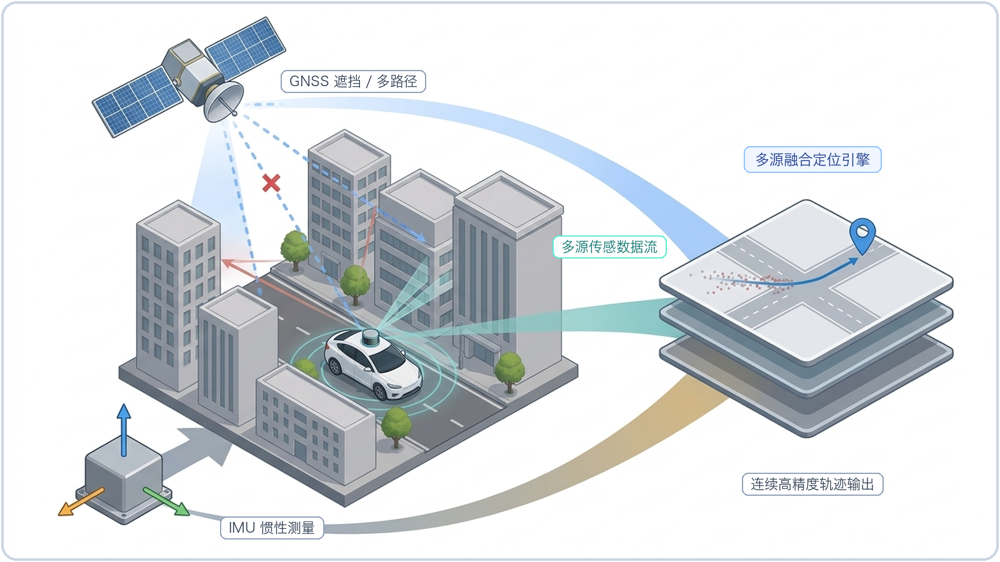
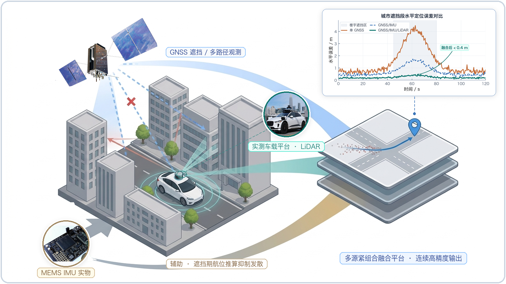

# 🛰️ nav-research-skills

**面向导航领域的 AI Skills · 从科研绘图到学术表达**

🧭 多源融合导航　·　📡 定位与感知　·　📊 科研可视化　·　🤝 研究协作

  
  
  

以导航科研需求为起点，也适用于其他科研领域的数据展示、工程表达与工作衔接。

---

## 项目定位

本仓库由 **ColourDyeing** 维护，汇集自主制作的导航科研技能与第三方实用技能，面向导航、定位、多源感知及其他相关科研领域的研究者。

将反复调整的绘图样式、工程插画要求和研究协作流程沉淀为可复用的 AI 工作说明，减少重复沟通，让精力更多地用于研究本身。当前主要围绕 Codex 工作流整理；在其他 AI 工具中的使用取决于其技能、脚本和图像工具支持。

| 方向 | 关注的问题 | 可拓展的科研用途 |
| :--- | :--- | :--- |
| 科研绘图 | 导航轨迹、ENU 误差、误差分布与多算法对比 | 实验结果可视化、统一图表样式、批量生成数据草图 |
| 学术插画 | 定位场景、多源感知、系统关系与工程部署 | 工程场景表达、技术路线展示、学术汇报配图 |
| 研究协作 | 查找适合任务的技能、保存持续研究的上下文 | 工具发现、项目交接、跨会话继续工作 |

## 收录技能

**自制技能的作者为 ColourDyeing；第三方技能保留原作者署名与许可证。** 下表中的技能名链接到仓库内的完整说明。

| Skill | 简介 | 作者 / 归属 | 版本 |
| :--- | :--- | :--- | :--- |
| [find-skills](find-skills/SKILL.md) | 检索、比较和安装适合任务的技能，连接 Skills CLI 与技能生态 | **Vercel** · 第三方收录 | 以收录内容为准 |
| [nav-sciplot](nav-sciplot/SKILL.md) | 基于 Matplotlib 与 SciencePlots 的导航科研绘图，支持中英文、自定义样式及 SVG / PDF / PNG 导出 | **ColourDyeing** · 自制 | **V2.0** · 2026-11-16 |
| [nav-illustrations](nav-illustrations/SKILL.md) | 面向导航与工程研究的学术插画，默认采用真实实物/科研图 + 矢量混合示意，支持单体、局部组合与全页系统图 | **ColourDyeing** · 自制（本地扩展） | **V2.1** · 2026-11-20 |
| [session-handoff](session-handoff/SKILL.md) | 将目标、进度、关键决策和后续任务整理为交接文档，便于继续研究工作 | **OneWave AI** · 第三方收录 | 以收录内容为准 |

### 自制技能 · V2.0 / V2.1 更新

- **nav-sciplot（V2.0）**：新增环境复用与本机环境记录，通过 `StyleConfig` 集中管理样式，支持按需依赖与独立复现包。
- **nav-illustrations（V2.0）**：扩展三种插画组织模式，按分类目录选择参考案例，增强可编辑标签和技术连线的交付。
- **nav-illustrations（V2.1 · 2.5D 美学保留 + 真实素材有机融合升级）**：
  - **2.5D 视觉骨架 + 真实素材有机嵌入（全局无条件遵守）**：在完整保留原版 V2.0 克制 2.5D 工程插画美感、统一透视与流畅动线的基础上，于关键技术节点原位融入真实卫星透明抠图、圆形硬件放大视窗（实测载体 / 传感器模组）及同色系定量科学图浮卡，既提升工程真实感与定量说服力，又杜绝退化为扁平照片方框拼贴；
  - **四项构图与文字硬核查**：空间尺度严格对齐、实物紧扣核心研究对象、同页文字去重与直白图意释义（严禁出现“模拟示例 / Placeholder”等破坏学术感的占位字样）、终端成果采用轻量化具象载具 + 极简短标签；
  - **主次与辅助视觉语法**：主线数据流与核心融合平台保持高辨识度，辅助支撑路径清晰标注作用机理，关键关系词直接压在对应连线上；
  - **PPTX 版式闭环与隐私保护**：新增 [`inspect_pptx_layout.py`](nav-illustrations/scripts/inspect_pptx_layout.py) 自动提取 `.pptx` 槽位比例、主色与字体，规范“原生可编辑版 + 一体化高清图版”双轨交付，并在 [`.gitignore`](.gitignore) 中严格忽略个人 `.pptx`/`.pdf`/`.docx`/`.xlsx`、本地环境记录与 `outputs/` 输出。

#### 效果对比：原版 V2.0 纯 AI 工程插画 vs. V2.1 2.5D 骨架 + 真实素材有机融合

<table>
  <tr>
    <th width="50%">原版 V2.0 · 纯 AI 克制 2.5D 工程插画 + 独立标签</th>
    <th width="50%">升级 V2.1 · 保留 2.5D 美学 + 真实实物与定量曲线融合</th>
  </tr>
  <tr>
    <td></td>
    <td></td>
  </tr>
  <tr>
    <td>遵循原版 V2.0 规范（白底克制 2.5D + 独立标签），构图清爽美观；但关键器件与定位结果均为概念化绘制，缺少实物锚点与定量误差支撑。</td>
    <td>完整保留原版 2.5D 建筑场景与流畅数据流骨架，同时将卫星原位升级为真实卫星抠图，通过圆形放大视窗嵌入实测车载平台与 MEMS IMU 实物，并在融合平台上方挂接同色系 <code>nav-sciplot</code> 定量误差对比曲线与贴线辅助关系标签。</td>
  </tr>
</table>

> 公开对比案例仅使用公开授权素材与脚本生成数据：导航卫星模型来自 Wikimedia Commons（Public Domain），车载感知实测平台来自 Wikimedia Commons（CC BY-SA 4.0），MEMS IMU 实物照来自 Wikimedia Commons（CC BY-SA 3.0），误差对比曲线由本仓库 <code>nav-sciplot</code> 绘制。

科研绘图侧重快速、批量的数据可视化与样式复用；投稿前仍需结合期刊要求精调。插画侧重技术关系和视觉表达，具体交付形式取决于可用的图像与演示文稿工具。

### 科研绘图案例

  

<em>nav-sciplot 案例展示 · 导航轨迹与多算法误差对比</em>

### 插画效果参考

  

<em>nav-illustrations 案例素材 · 用于构图与表达参考</em>

### 第三方技能原文

| Skill | 原作者 | 原文链接 | 许可 |
| :--- | :--- | :--- | :--- |
| find-skills | Vercel | https://github.com/vercel-labs/skills/tree/main/skills/find-skills | [MIT](find-skills/LICENSE) |
| session-handoff | OneWave AI | https://github.com/OneWave-AI/claude-skills/tree/main/session-handoff | [MIT](session-handoff/LICENSE) |

第三方技能的原始贡献归原作者所有。本仓库收录版本与上游可能存在差异，最新内容及维护说明请以原项目为准。

## 更多科研技能项目

以下项目来自共享手册中的拓展推荐，**未打包收录在本仓库中**。作者栏使用项目维护者的 GitHub 账号。

| 项目 | 作者 / 维护者 | 主要方向 |
| :--- | :--- | :--- |
| **nature-skills** | Yuan1z0825 | 学术阅读、写作润色、科研绘图与汇报表达 |
| **ARS-Codex** · academic-research-skills-codex | Imbad0202 | 面向 Codex 的学术研究流程，覆盖文献、研究问题、论文与修订 |
| **CCFA-Skills** | mikubaka88 | 面向 CCF-A 研究与写作，覆盖选题、文献、实验设计、可视化及审稿回复 |

- **nature-skills**：https://github.com/Yuan1z0825/nature-skills
- **ARS-Codex**：https://github.com/Imbad0202/academic-research-skills-codex
- **CCFA-Skills**：https://github.com/mikubaka88/CCFA-Skills

## 仓库与交流

**维护者：ColourDyeing**

- **GitHub**：https://github.com/ColourDyeing/nav-research-skills

欢迎通过 Issues 或合并请求反馈需求、改进技能和补充科研案例。贡献第三方内容时，请注明原作者、原文链接及适用许可证；个人数据、本机环境记录和临时输出不纳入共享内容。

## 署名与许可

`nav-sciplot` 与 `nav-illustrations` 由 ColourDyeing 制作和维护；`find-skills` 与 `session-handoff` 分别来自 Vercel 和 OneWave AI，并保留各自的 MIT 许可证。

本仓库尚未声明统一许可证。第三方技能遵循各自许可证；自制技能及参考素材的使用、修改与再分发范围，不因仓库公开而自动获得统一授权。需要进一步使用或分发时，请联系维护者确认相应内容的许可。
